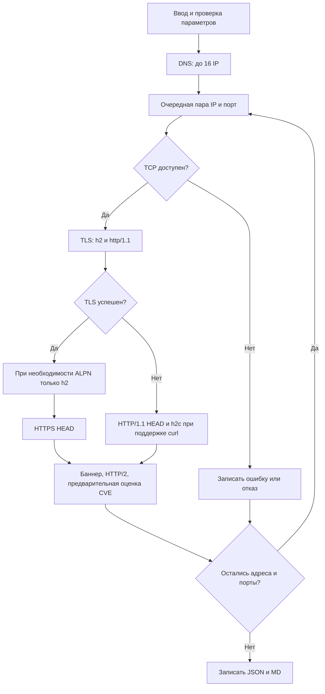

# NGINX HTTP/2 Check

Утилита неразрушающей сетевой диагностики NGINX, TLS и HTTP/2 для предварительной оценки применимости CVE-2026-123007 и CVE-2026-123633.

**Версия:** 1.0 ([vit81g (Vitaliy S. Novikov)](https://github.com/vit81g))  
**Ответственный:** руководитель службы кибербезопасности [Новиков Виталий Сергеевич](https://wiki.port.one/display/~vs.novikov), администратор ИБ Шелехов Виктор Михайлович  
**Дата:** 11.2026

> Редакция документации: расширены комментарии и docstring, сохранена логика версии 1.0. Использовать только в пределах согласованной области проверки. Утилита не подтверждает эксплуатацию CVE и не является заменой проверки пакетов на сервере.

## Содержание

- [Назначение](#назначение)
- [Требования и установка](#требования-и-установка)
- [Запуск](#запуск)
- [Параметры](#параметры)
- [Алгоритм](#алгоритм)
- [Структура кода](#структура-кода)
- [Формат результатов](#формат-результатов)
- [Оценка CVE](#оценка-cve)
- [Ограничения](#ограничения)
- [Проверка и сопровождение](#проверка-и-сопровождение)
- [Источники](#источники)

## Назначение

Скрипт предназначен для специалистов ИБ, выполняющих первичное обследование согласованных веб-сервисов из корпоративной сети, внешнего VDS или сети управления. Проверяет один FQDN или IP за запуск, раскрывает DNS-адреса, проверяет TCP-доступность и выполняет стандартные TLS-рукопожатия и HTTP HEAD-запросы. Результаты сохраняются в Markdown и JSON.

Не выполняет эксплуатацию уязвимостей, подбор паролей, SSH-подключения, изменение настроек, рекурсивный обход сайтов или переходы по перенаправлениям. Даже обычные сетевые запросы могут отражаться в журналах IDS/IPS и приложений, поэтому проверка должна быть согласована.

| Возможность | Реализация |
|---|---|
| Ввод цели | В интерактивном режиме или CLI |
| Порты | 14 стандартных либо до 64 вручную |
| IPv4/IPv6 | DNS и отдельная проверка каждого адреса (до 16) |
| TLS и ALPN | Python `ssl`, с фиксацией доверия к сертификату |
| HTTP/1.1, HTTP/2, h2c | Внешняя программа `curl` |
| Идентификация NGINX | Заголовок `Server` |
| CVE | Предварительная классификация по статическим правилам |
| Отчёты | MD и JSON, UTC-метки |

## Требования и установка

- Linux (практическая целевая среда — Ubuntu/Debian).
- Python 3.8+; используются только модули стандартной библиотеки.
- `curl` с поддержкой HTTP/2 для полного набора проверок.
- Доступ к согласованному хосту по сети; root не требуется для запуска.

```bash
sudo apt update
sudo apt install python3 curl
python3 --version
curl -V
```

Пример фрагмента `curl -V` (иллюстративный):

```text
Features: alt-svc AsynchDNS HTTP2 HTTPS-proxy IPv6 SSL UnixSockets
```

Если `HTTP2` отсутствует, Python продолжит TLS ALPN-проверки, а curl — HTTP/1.1-запросы. Проверка h2c не выполняется.

Структура репозитория:

```text
.
├── nginx_http2_check.py
├── README.md
└── nginx_reports/            # создаётся при запуске
```

Рекомендуется исключить отчёты из публичного Git-репозитория через `.gitignore`. Они содержат внутренние адреса, имена хостов и результаты проверки.

## Запуск

### Интерактивный режим

```bash
python3 nginx_http2_check.py
```

```text
Хост (FQDN/IP): web.example.com
Порт(ы) [Enter = auto]:
Точка проверки [corp/vds/mgmt]: corp
```

В примерах используется зарезервированный демонстрационный домен `example.com`. Заменять его следует только на согласованные цели. Входные данные — имя или IP, не URL, не CIDR и не список хостов.

### Автоматический выбор портов

```bash
python3 nginx_http2_check.py --host web.example.com --ports auto --zone corp
```

Проверяются порты `80, 443, 1443, 3000, 4200, 5000, 8000, 8008, 8080, 8081, 8443, 8888, 9000, 9443`. Пустое поле в интерактивном режиме эквивалентно `auto`. Это фиксированный список, а не обнаружение всех открытых портов хоста.

### Конкретные порты

```bash
python3 nginx_http2_check.py --host web.example.com --ports 443,8443 --zone corp
```

### Проверка с внешнего VDS или из сети управления

```bash
python3 nginx_http2_check.py --host web.example.com --ports 443 --zone vds
python3 nginx_http2_check.py --host web.example.com --ports 443 --zone mgmt
```

| Зона | Значение |
|---|---|
| `corp` | Корпоративная сеть |
| `vds` | Внешняя точка проверки |
| `mgmt` | Сеть управления (Management) |

Зона является меткой оператора, не меняет маршрутизацию, VRF, исходный интерфейс, VPN или DNS. Для достоверного сравнения необходимо запускать скрипт из соответствующих сегментов. При выборе `vds` и обнаружении непубличного IP выводится предупреждение.

### Доверенный корпоративный CA

```bash
python3 nginx_http2_check.py --host web.example.com --ports 443 --zone corp \
  --ca-file /path/to/trusted-root-ca.pem
```

Корневой сертификат нужно получить из доверенного корпоративного источника. `--noproxy '*'` исключает прокси curl, но не прозрачную TLS-инспекцию.

Опциональная диагностика недоверенного HTTPS:

```bash
python3 nginx_http2_check.py --host web.example.com --ports 443 --zone corp \
  --insecure-diagnostics
```

При ошибке curl 60 позволяет повторить HEAD без проверки сертификата. Такой ответ не доказывает идентичность сервера. Независимо от этого флага Python при ошибке сертификата повторяет только TLS-рукопожатие без доверенной проверки для получения ALPN; результат явно отмечается как `cert_verified: false`. Не передаются учётные данные.

## Параметры

```bash
python3 nginx_http2_check.py --help
```

| CLI | Значение | По умолчанию |
|---|---|---|
| `--host` | Один FQDN, короткое имя или IP | Интерактивный ввод |
| `--ports` | `auto` или порты через запятую | Интерактивный ввод |
| `--zone` | `corp`, `vds`, `mgmt` | Интерактивный ввод |
| `--ca-file` | Путь к доверенному CA (PEM) | Системное доверие |
| `--insecure-diagnostics` | Разрешить повтор HTTPS HEAD без проверки CA после ошибки 60 | Выключено |
| `--out` | Каталог результатов | `nginx_reports` |
| `-h`, `--help` | Справка | — |

## Алгоритм



TLS сначала проверяется с валидацией сертификата; возможен диагностический повтор ALPN без неё. При успешном TLS скрипт не проверяет обычный HTTP на том же порту. При неудачном TLS выполняются HTTP/1.1 и, при поддержке curl, cleartext HTTP/2 с prior knowledge. Запросы последовательные с паузой 0,15 с после каждой пары IP:порт.

## Структура кода

Код оформлен в соответствии с основными соглашениями PEP 8 (snake_case, константы UPPER_CASE, отступы 4 пробела, длина строк до 79 символов) и содержит русскоязычные docstring по PEP 257 с описанием аргументов, результатов, исключений и существенных ограничений. Комментарии объясняют назначение и причины нетривиальных операций, а не дублируют каждую строку.

### Константы

| Имя | Тип | Назначение |
|---|---|---|
| `PORTS` | tuple[int] | Предустановленные TCP-порты |
| `CVE` | dict[str, tuple] | Нижние границы диапазонов версий для текущих правил |
| `ADVISORY` | str | URL официального бюллетеня NGINX |
| `TIMEOUT` | int | Тайм-аут сокета и подключения curl, 3 с |

### Функции

| Функция | Аргументы | Возвращает / действие |
|---|---|---|
| `host_name` | `value` | Нормализованное имя/IP; отклоняет неправильный ввод |
| `parse_ports` | `raw` | Список целых портов, проверяет ограничения |
| `tls_probe` | `host`, `ip`, `port`, `protocols`, `cafile` | Словарь результатов TLS |
| `attempt` (вложенная) | `verified` | Обновляет результаты TLS одной попыткой |
| `curl_head` | `host`, `ip`, `port`, `scheme`, `mode`, `cafile`, `insecure` | Метаданные HTTP HEAD-запроса |
| `indicators` | `row` | Признаки NGINX/HTTP2 и оценки CVE |
| `examine` | `host`, `ip`, `port`, `h2_curl`, `cafile`, `insecure` | Полная проверка пары адрес:порт |
| `clean` | `value` | Экранирование разделителя Markdown и удаление переводов строк |
| `markdown` | `report` | Формирование MD-отчёта |
| `main` | Аргументы CLI / stdin | Оркестрация, консольный вывод, сохранение файлов |

### Основные переменные и структуры

| Имя | Назначение |
|---|---|
| `host`, `ip`, `port`, `ips`, `ports` | Исходное имя, адрес, порт, списки адресов и портов |
| `value`, `raw`, `nums` | Входная строка цели, строка портов, разобранные числа |
| `zone`, `args`, `parser` | Метка точки проверки и параметры CLI |
| `protocols`, `verified`, `cafile`, `ctx`, `sock`, `tls` | Параметры TLS, контекст и сетевые сокеты |
| `result`, `row`, `report` | Результаты отдельной пробы, пары IP:порт, всего запуска |
| `scheme`, `mode`, `insecure`, `url`, `literal`, `addr` | Параметры HTTP-пробы, URL и оформление IP-литералов |
| `proc`, `last_server`, `line`, `fields`, `ver`, `code`, `remote` | Вывод curl и выделенные поля |
| `probes`, `h2`, `banners`, `versions`, `nginx`, `assessments` | Признаки и результаты классификации |
| `cve`, `minimum`, `v`, `fixed`, `status` | Проверяемая CVE, граница версии, версия и итоговое правило |
| `first`, `response`, `h2_curl`, `features` | Первая TLS-проба, HTTP-ответ, наличие HTTP2 в curl |
| `lines`, `cells`, `r`, `x`, `val` | Строки отчёта, ячейки, текущие элементы при форматировании |
| `out`, `stamp`, `base`, `suffix`, `data`, `path` | Каталог, UTC-метка, имя файла и содержимое |
| `e`, `retry` | Исключения сетевых и TLS-проверок |

## Формат результатов

Пример консольного вывода (иллюстративный, не результат реального сканирования):

```text
Точка: corp; хост: web.example.com; DNS: 192.0.2.10; порты: [443, 8443]
  192.0.2.10:443 ... open HTTP/2=True nginx/1.27.5
  192.0.2.10:8443 ... refused HTTP/2=-
Отчет: nginx_reports/web.example.com_corp_20261119T120000000000Z.json
Отчет: nginx_reports/web.example.com_corp_20261119T120000000000Z.md
```

MD-таблица (иллюстративная):

| IP | Порт | TCP | Источник | TLS / ALPN | HTTP | Server | HTTP/2 |
|---|---:|---|---|---|---|---|---|
| 192.0.2.10 | 443 | open | 192.0.2.20 | TLSv1.3 / h2 (CA: True) | https 2 200 | nginx/1.27.5 | да |
| 192.0.2.10 | 8443 | refused | - | - | - | - | не проверен |

### JSON: основные поля

| Уровень | Поля |
|---|---|
| Отчёт | `version`, `time`, `host`, `zone`, `scanner`, `addresses`, `ports`, `curl_http2`, `insecure_diagnostics`, `results` |
| Результат порта | `ip`, `port`, `tcp`, `source_ip`, `tls_probes`, `http`; `tcp_error` при некоторых ошибках |
| TLS-проба | `offered`, `ok`, `alpn`, `tls`, `cert_verified`, `error` |
| HTTP-проба | `scheme`, `mode`, `insecure`, `http_version`, `http_code`, `server`, `remote_ip`, `redirect`, `error`, `returncode` (если curl завершился) |
| Оценка доступного порта | `h2_detected`, `server_banners`, `nginx_versions`, `assessment` |

`tcp=open` означает успешное TCP-соединение. `refused` — отказ соединения. `unreachable_or_timeout` — другая сетевая ошибка или тайм-аут; это не обязательно закрытый порт. `cert_verified=null` означает, что доверие не было установлено. `ok=true` само по себе не гарантирует доверие сертификату.

## Оценка CVE

В версии 1.0 используются правила исходного скрипта, а не динамическая база уязвимостей. При использовании необходимо сверять актуальность диапазонов с [NGINX Security Advisories](https://nginx.org/en/security_advisories.html) и бюллетенем поставщика установленной сборки.

| Наблюдение | Статус скрипта |
|---|---|
| Баннер не содержит NGINX | NGINX не подтверждён по баннеру |
| NGINX обнаружен, HTTP/2 не обнаружен | Проверить конфигурацию |
| NGINX + HTTP/2, версия скрыта или неоднозначна | Требуется проверка версии |
| Баннер входит в заданный диапазон | Потенциально применима; проверить сборку/backport |
| Баннер соответствует заданной исправленной версии | Проверить установленный пакет |
| Баннер вне заданного диапазона | Проверить пакет |

В коде нижние границы заданы как `1.9.5` и `1.19.7`, верхняя — `1.31.8`; исключение для исправленной stable-ветки начинается с `1.30.7`, а mainline — `1.31.9`. Это описание существующей реализации, а не независимая верификация актуального диапазона. Для CVE-2026-123633 также явно указывается, что дополнительные условия upstream и исчерпания соединений не проверены.

Статусы не следует использовать для автоматического закрытия уязвимостей. Приоритет определяется после проверки версии работающего бинарного файла, ревизии пакета, backport, действующей конфигурации и сетевой доступности.

## Ограничения

- Проверяются только один хост, разрешённые DNS-адреса и заданные TCP-порты. Автоматический поиск всех портов не предусмотрен.
- Проверяется путь `/` методом HEAD. HTTP-редирект фиксируется, но не выполняется. Другие виртуальные хосты, интерфейсы и маршруты могут иметь иную конфигурацию.
- `Server` может быть скрыт или подменён; ALPN может принадлежать WAF, балансировщику или TLS-inspection. Сочетание ALPN и баннера не доказывает, что их сформировал один процесс.
- Отсутствие HTTP/2 не доказывает, что он выключен. В JSON `h2_detected=false` означает отсутствие положительного результата, включая ошибки проб.
- Проверка h2c выполняется только с prior knowledge; вариант Upgrade отдельно не проверяется.
- Версия из баннера не позволяет подтвердить наличие backport. Утилита не анализирует SSH, Docker, пакеты или конфигурацию NGINX.
- Неизвестный или недоверенный сертификат требует проверки PKI. Результаты без валидации нельзя считать доказательством подлинности сервиса.
- Тайм-ауты заданы на отдельные операции; общее время зависит от DNS, числа адресов, портов и сетевых ошибок.
- Отчёты записываются после завершения цикла. При прерывании запуска частичный отчёт не гарантируется.
- Полные HTTP-заголовки, тело ответа и cookies не записываются намеренно. Диагностические сообщения могут содержать сетевые имена и адреса; отчёты необходимо проверять перед публикацией.
- Статические правила CVE требуют актуализации; версия 1.0 не проверяет обновления бюллетеней автоматически.

## Проверка и сопровождение

```bash
python3 -m py_compile nginx_http2_check.py
python3 nginx_http2_check.py --help
```

При наличии установленных линтеров:

```bash
python3 -m pycodestyle --max-line-length=79 nginx_http2_check.py
```

Расширение функциональности (новые CVE, массовый импорт, дополнительные порты или интеграция со сканером) должно сопровождаться отдельной версией и проверкой на TEST. Редакция документации не меняет сетевую логику и формат отчётов исходной версии.

Проверка в PROD требует согласования. Для первой проверки рекомендуется один разрешённый тестовый адрес и порт; затем сопоставить результаты скрипта с командами на сервере и штатным сканером уязвимостей.

## Источники

- [PEP 8 — Style Guide for Python Code](https://peps.python.org/pep-0008/)
- [PEP 257 — Docstring Conventions](https://peps.python.org/pep-0257/)
- [NGINX Security Advisories](https://nginx.org/en/security_advisories.html)
- [NGINX HTTP/2 Module](https://nginx.org/en/docs/http/ngx_http_v2_module.html)
- [curl — man page](https://curl.se/docs/manpage.html)
- [curl — TLS certificate verification](https://curl.se/docs/sslcerts.html)
- [Python — ssl](https://docs.python.org/3/library/ssl.html)
- [Python — socket](https://docs.python.org/3/library/socket.html)
- [Python — subprocess](https://docs.python.org/3/library/subprocess.html)

Документ предназначен для внутреннего использования. Лицензия на распространение исходного кода отдельно не установлена.
