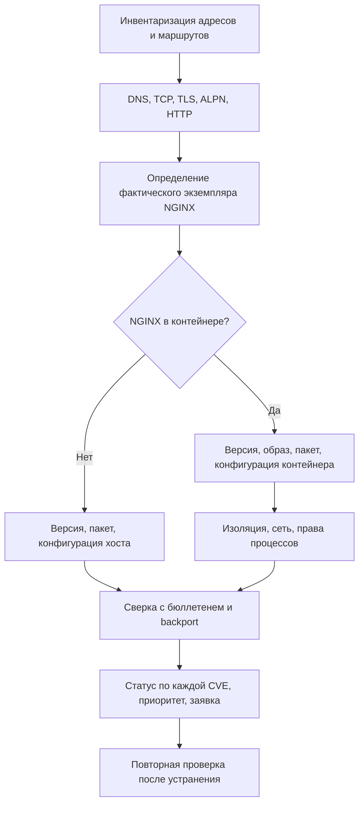

# Методика проверки применимости уязвимостей NGINX (HTTP/2) в инфраструктуре ГК ППК

**Версия:** 1.0 ([vit81g (Vitaliy S. Novikov)](https://github.com/vit81g))  
**Ответственный:** руководитель службы кибербезопасности Новиков Виталий Сергеевич  
**Дата:** 11.2026  
**Область проверки:** CVE-2026-123007, CVE-2026-123633  

## 1. Цель и область применения

Методика предназначена для безопасного определения применимости уязвимостей NGINX к опубликованным и внутренним веб-сервисам, обратным прокси, балансировщикам и контейнеризированным компонентам. Она позволяет установить версию и происхождение сборки, наличие необходимых конфигурационных предпосылок, доступность HTTP/2 из разных сегментов и остаточные риски при возможной компрометации контейнера.

Основание: отчёт службы кибербезопасности `NGINX_CVE_assessment_2026-11-19.md` по Blitz IdP и MaxPatrol VM. Методика расширяет отчёт дополнительными диагностическими проверками. Примеры на `auth.cplus.ru` и `cdc-mpvm-cor01` отражают ранее полученные результаты, если прямо отмечены как фактические. Остальные примеры являются иллюстративными, а не результатами выполненных проверок.

### 1.1. Сведения об уязвимостях

| Параметр | CVE-2026-123007 | CVE-2026-123633 |
|---|---|---|
| Тип | Повреждение памяти при управлении потоком HTTP/2 | Use-after-free при обработке HTTP/2 и соединении с upstream |
| Уязвимые upstream-версии | 1.9.5–1.31.8 | 1.19.7–1.31.8 |
| Исправленные upstream-релизы | 1.30.7+, 1.31.9+ в соответствующих ветках | 1.30.7+, 1.31.9+ в соответствующих ветках |
| Основные конфигурационные предпосылки | Активный HTTP/2 на слушающем порту | Активный HTTP/2 и передача запросов на upstream |
| Возможный эффект | RCE с правами worker-процесса, нарушение доступности | RCE с правами worker-процесса, нарушение доступности |
| CVSS (по CERT-EU) | 8.1 | 8.1 |
| Временная мера при невозможности обновления | Отключение HTTP/2 | Отключение HTTP/2 |

Источники: [NGINX Security Advisories][1], [CERT-EU 2026-022][2], [NGINX News, 18.11.2026][3]. Из уязвимых диапазонов необходимо исключать исправленные upstream-релизы и сборки с подтверждённым backport. CVSS следует фиксировать с указанием вектора, версии шкалы и источника; оценку из одной шкалы нельзя автоматически использовать вместо другой для KPI. Конфигурационные предпосылки не равнозначны доказательству успешной эксплуатации.

### 1.2. Правила проведения работ

- Проверять только согласованные активы ГК ППК и разрешённые точки подключения.
- На PROD использовать обычные HTTP-запросы, TLS-согласование и чтение метаданных/конфигурации. Не запускать эксплуатационные PoC, не выполнять нагрузочные проверки, не менять конфигурацию и не перезапускать службы в рамках этой методики.
- Проверять каждый разрешённый FQDN, VIP, порт, виртуальный хост и применимый сетевой маршрут; результаты из корпоративной сети нельзя переносить на внешний периметр без проверки.
- Вендорские контейнеры обновлять только согласованным способом. Не устанавливать SSH, утилиты и не выполнять `apk upgrade` непосредственно в рабочем контейнере.
- Не сохранять открытые пароли, токены, cookies, содержимое закрытых ключей, переменные окружения с секретами. Полные конфигурации и журналы при необходимости хранить только в защищённом хранилище.
- При обнаружении аварийных завершений, ухудшении доступности или другого нежелательного эффекта прекратить активную проверку и действовать по регламенту эксплуатации и реагирования.

## 2. Порядок проверки



## 3. Подготовка рабочего места

Команды рассчитаны на Linux (например, Ubuntu/Debian или Kali) с Bash на проверяющей машине; внутри Alpine используется `/bin/sh`. Понадобятся `curl` с HTTP/2, `openssl`, `getent`/`dig`, `timeout`, `grep`, `ss`, при необходимости `nc` и доступ к Docker на целевом хосте. Если утилита отсутствует в контейнере, использовать имеющиеся инструменты хоста или согласованный диагностический способ, не устанавливая пакеты в PROD.

### 3.1. Проверка инструментов

```bash
curl -V
openssl version
command -v dig getent nc timeout
```

Пример вывода (иллюстративный):

```text
curl 8.13.0 ... OpenSSL/3.x ... nghttp2/...
Features: ... HTTP2 ... SSL ...
OpenSSL 3.x.x
/usr/bin/dig
/usr/bin/getent
/usr/bin/nc
/usr/bin/timeout
```

`HTTP2` в `Features` необходим для HTTP/2-проверок curl. Отсутствие функции у клиента не является признаком отключённого HTTP/2 на сервере.

### 3.2. Переменные и папка доказательств

```bash
HOST='auth.cplus.ru'   # заменить на проверяемый FQDN
PORT=443
HTTP_PORT=80
URI='/'                # допустимый маршрут приложения
SOURCE='corp'          # corp / vds / mgmt
umask 077
OUT="nginx-check-${HOST}-${SOURCE}-$(date -u +%Y%m%dT%H%M%SZ)"
mkdir -p "$OUT"
{
  date -u +'%FT%TZ'
  hostname
  printf 'Target=%s:%s Source=%s\n' "$HOST" "$PORT" "$SOURCE"
} | tee "$OUT/context.txt"
```

Пример: `Target=auth.cplus.ru:443 Source=corp`. Повторять блок с нужными переменными для каждого объекта и точки проверки. `umask 077` ограничивает доступ к вновь создаваемым локальным файлам; правила хранения доказательств определяются внутренним регламентом.

## 4. Сетевая проверка (корпоративная сеть и внешний VDS)

### 4.1. Определение IP-адресов и маршрута

```bash
getent ahosts "$HOST"
dig +short "$HOST" A
dig +short "$HOST" AAAA
```

Фактический адрес Blitz в корпоративной сети: `10.14.91.165`. Пример вывода `dig`:

```text
10.14.91.165
```

Для проверки маршрута к конкретному полученному адресу:

```bash
IP='10.14.91.165'      # заменить на фактический адрес
ip route get "$IP"
```

Пример (иллюстративный):

```text
10.14.91.165 via 10.14.90.1 dev eth0 src 10.14.90.20
```

Частный IP не доказывает отсутствие публичного VIP. Повторить DNS-проверку с внешнего VDS и сопоставить с реестром публикаций/DNAT. Учитывать split DNS, IPv6 и балансировку; не обращаться к внутренним адресам через несогласованные маршруты.

### 4.2. Проверка TCP-доступности

```bash
nc -vz -w 3 "$HOST" "$PORT"
nc -vz -w 3 "$HOST" "$HTTP_PORT"
```

Примеры (иллюстративные):

```text
Connection to auth.cplus.ru 443 port [tcp/https] succeeded!
```

```text
nc: connect to auth.cplus.ru port 80 (tcp) failed: Connection refused
```

Успех подтверждает TCP, но не конкретный протокол и не версию ПО. `refused` и `timeout` означают отсутствие успешного соединения с данной точки; причину уточнить по NGFW/ACL и слушающим сокетам.

### 4.3. Проверка HTTPS и серверного баннера

```bash
curl --noproxy '*' -sSI --http2 \
  --connect-timeout 5 --max-time 15 "https://${HOST}:${PORT}${URI}" \
  | grep -Ei '^(HTTP/|server:|date:|location:)'
```

Примеры (по ранее полученным ответам):

```http
HTTP/1.1 301 Moved Permanently
Server: nginx/1.26.0
Location: https://www.port.one/
```

```http
HTTP/2 200
server: nginx
```

Первая запись показывает баннер версии и перенаправление; вторая — HTTP/2 и баннер без версии. `--http2` допускает переход на HTTP/1.1, поэтому следует смотреть фактическую версию ответа. `HEAD` может не поддерживаться приложением: при необходимости использовать GET из п. 4.5.

Не применять `-k` по умолчанию. Если доверенный CA пока недоступен, отдельная диагностическая проверка `curl -k` может установить только протокол/ответ, но не подлинность сервера; без учётных данных и только в согласованном контуре. Такой результат явно пометить как проверку без валидации TLS.

### 4.4. Проверка согласования ALPN

Предлагаем только HTTP/2:

```bash
timeout 15 openssl s_client \
  -connect "${HOST}:${PORT}" -servername "$HOST" \
  -alpn h2 </dev/null > "$OUT/alpn-h2.txt" 2>&1
grep -E 'ALPN protocol|No ALPN|Verify return code|error:' "$OUT/alpn-h2.txt"
```

Предлагаем оба протокола:

```bash
timeout 15 openssl s_client \
  -connect "${HOST}:${PORT}" -servername "$HOST" \
  -alpn 'h2,http/1.1' </dev/null > "$OUT/alpn-both.txt" 2>&1
grep -E 'ALPN protocol|No ALPN|Verify return code|error:' "$OUT/alpn-both.txt"
```

| Вывод | Интерпретация |
|---|---|
| `ALPN protocol: h2` | HTTP/2 согласован на данной TLS-точке |
| `ALPN protocol: http/1.1` | Выбран HTTP/1.1; проверить также предложение только h2 |
| `No ALPN negotiated` | ALPN не согласован; не доказательство полного отключения HTTP/2 |
| Ошибка TLS / timeout | Проверка не завершена; необходима диагностика |

Фактически получено: Blitz — `No ALPN negotiated` при предложении h2 и `ALPN protocol: http/1.1` при предложении обоих; MaxPatrol VM — `ALPN protocol: h2`.

`openssl s_client` без строгой проверки сертификата является диагностическим инструментом. Для подтверждения доверия использовать п. 4.8. ALPN описывает TLS-терминатор, а не обязательно конечный NGINX за WAF/прокси.

### 4.5. Проверка фактического HTTP GET

```bash
curl --noproxy '*' -sS --http2 \
  --connect-timeout 5 --max-time 15 \
  -D - -o /dev/null \
  -w '\nHTTP_VERSION=%{http_version} REMOTE_IP=%{remote_ip} CODE=%{http_code}\n' \
  "https://${HOST}:${PORT}${URI}" \
  | grep -Ei '^(HTTP/|server:|location:|HTTP_VERSION=)'
```

Для Blitz использовать `URI='/idp/profile'`. Фактические значимые строки из ранее предоставленного лога:

```http
HTTP/1.1 303 See Other
Server: nginx/1.26.0
Location: /idp/login/methods/spnego?bo=%2Fidp%2Fprofile%3F
```

Для MaxPatrol VM получен `HTTP/2 200` и `server: nginx` при HEAD-запросе. Иллюстративный вывод поля `-w`: `HTTP_VERSION=2 REMOTE_IP=192.0.2.20 CODE=200` (IP условный).

Успешный обмен HTTP/2 подтверждает обработку протокола, а не наличие CVE. Коды 200/301/303/401/403 не определяют статус уязвимости; отдельные маршруты могут иметь различную обработку.

### 4.6. Проверка HTTP/2 без TLS (h2c)

Если на согласованном адресе имеется HTTP-порт:

```bash
curl --noproxy '*' -sS --http2-prior-knowledge \
  --connect-timeout 5 --max-time 10 \
  -D - -o /dev/null \
  -w '\nHTTP_VERSION=%{http_version} CODE=%{http_code}\n' \
  "http://${HOST}:${HTTP_PORT}/" \
  | grep -Ei '^(HTTP/|server:|HTTP_VERSION=)'
```

Возможные результаты:

```text
HTTP/2 200
HTTP_VERSION=2 CODE=200
```

```text
curl: (16) Error in the HTTP2 framing layer
```

Первый — подтверждение h2c (пример); второй — ошибка протокола (фактически получена при предыдущем тесте Blitz, но с расхождением `:authority`, поэтому тест нужно повторять с корректным FQDN). Отказ не доказывает невозможности HTTP/2 на всех портах и виртуальных хостах. Проверять только стандартным клиентом, без специально сформированных кадров.

### 4.7. Перенаправления, отдельные адреса и виртуальные хосты

Сначала проверить `Location` без `-L`. Если целевые адреса входят в согласованный периметр, проверить каждый отдельно. Для уже согласованной цепочки:

```bash
curl --noproxy '*' -sSI -L --max-redirs 5 --http2 \
  --proto '=https' --proto-redir '=https' \
  --connect-timeout 5 --max-time 20 "https://${HOST}:${PORT}/" \
  | grep -Ei '^(HTTP/|server:|location:)'
```

Для проверки каждого известного IPv4 VIP с сохранением правильного SNI и Host:

```bash
IP='192.0.2.20'      # пример адреса; заменить согласованным IP
curl --noproxy '*' -sSI --http2 \
  --resolve "${HOST}:${PORT}:${IP}" \
  --connect-timeout 5 --max-time 15 "https://${HOST}:${PORT}/"
```

Пример: `HTTP/2 200` либо `HTTP/1.1 200 OK`. При нескольких IP повторить для каждого (для IPv6 использовать синтаксис curl с квадратными скобками вокруг адреса). Не обходить действующие ограничения доступа: проверка предназначена для согласованных сетевых маршрутов и узлов.

### 4.8. Проверка сертификатов и TLS Inspection

```bash
timeout 15 openssl s_client \
  -connect "${HOST}:${PORT}" -servername "$HOST" \
  -showcerts -verify_hostname "$HOST" -verify_return_error </dev/null
```

Успешный пример: `Verify return code: 0 (ok)`.

Фактически получено при переходе на `www.port.one`:

```text
CN=Port One Root CA
verify error:num=19:self-signed certificate in certificate chain
Verify return code: 19 (self-signed certificate in certificate chain)
```

В ранее представленном журнале цепочка `port.one` → `ppk-pan01.port.one` → `Port One Root CA` согласуется с TLS-инспекцией. Необходимо сверить с правилом NGFW; `--noproxy '*'` не отключает прозрачную инспекцию. Для проверки с доверенным CA, полученным из корпоративного PKI:

```bash
curl --cacert /path/to/approved-ca-bundle.crt --noproxy '*' \
  -sSI --http2 --max-time 15 "https://${HOST}:${PORT}/"
```

Путь заменить фактическим. Не импортировать CA, полученный исключительно из недоверенного соединения. При TLS-инспекции ALPN характеризует проверяемый участок; при необходимости согласованно сопоставить данные с другим участком соединения и конфигурацией TLS-терминатора.

## 5. Проверка непосредственно на хосте NGINX

Выполнять через согласованный административный доступ. Для контейнерного NGINX перейти к разделу 6 после определения процесса и порта. Не считать наличие бинарного файла на хосте доказательством того, что именно он обслуживает запросы.

### 5.1. Определение процесса, портов и способа запуска

```bash
hostname -f
cat /etc/os-release
sudo ss -lntp
sudo ss -lntp 'sport = :443'
ps -eo pid,ppid,user,args | grep '[n]ginx'
```

Пример (иллюстративный):

```text
LISTEN 0 511 0.0.0.0:443 0.0.0.0:* users:(("nginx",pid=1200,fd=8))
1200 1 root nginx: master process /usr/sbin/nginx
1201 1200 www-data nginx: worker process
```

Если на порту работает `docker-proxy`, балансировщик или иной процесс, проверить соответствующее отображение порта и контейнер. Отсутствие `docker-proxy` не исключает Docker DNAT. При системной службе дополнительно:

```bash
sudo systemctl status nginx --no-pager
sudo systemctl show nginx -p MainPID -p ExecStart -p ExecReload
sudo systemctl cat nginx
```

Пример: `MainPID=1200`, `Active: active (running)`. Сверить параметры `-c`, `-p`, путь к бинарному файлу и процессу. Команды systemctl применимы только к systemd-службам.

### 5.2. Версия работающего экземпляра и параметры сборки

```bash
nginx -v
nginx -V 2>&1
```

Иллюстративный результат:

```text
nginx version: nginx/1.26.0
configure arguments: ... --with-http_ssl_module --with-http_v2_module ...
```

`--with-http_v2_module` означает наличие штатного модуля HTTP/2 в сборке, а не его активацию. Для исключения расхождения между установленным файлом и запущенным процессом (PID взять из п. 5.1):

```bash
PID=1200  # условный PID master-процесса
sudo readlink /proc/$PID/exe
sudo /proc/$PID/exe -v
```

Пример: `/usr/sbin/nginx` и `nginx version: nginx/1.26.0`. Если путь содержит `(deleted)`, вероятно, запускается старый экземпляр бинарного файла, уже заменённого на диске; уточнить историю обновления. Не перезапускать службу в ходе диагностики.

### 5.3. Проверка конфигурации

Вначале убедиться, что команда использует тот же бинарный файл, prefix и файл конфигурации, что и master-процесс (при нестандартных параметрах добавить соответствующие `-p` и `-c`).

```bash
sudo nginx -t
sudo nginx -T 2>&1 | grep -nE '^[[:space:]]*(listen|http2|server_name|proxy_pass|grpc_pass|upstream|worker_connections|worker_rlimit_nofile|server_tokens)[[:space:]]'
```

Пример успешной проверки:

```text
nginx: the configuration file /etc/nginx/nginx.conf syntax is ok
nginx: configuration file /etc/nginx/nginx.conf test is successful
```

Фактические активные строки из предоставленной конфигурации Blitz:

```nginx
260:    listen          80;
291:    listen          443 ssl;
469:    listen 80 default_server;
470:    listen [::]:80 default_server;
```

Иллюстративный вывод при включённом HTTP/2:

```nginx
listen 443 ssl;
http2 on;
```

Либо для прежнего синтаксиса:

```nginx
listen 443 ssl http2;
```

| Конфигурация | Интерпретация |
|---|---|
| `http2 on;` | HTTP/2 активирован в соответствующем контексте |
| `listen 443 ssl http2;` | Старый синтаксис включения HTTP/2 |
| `http2 off;` | HTTP/2 отключён в соответствующем контексте |
| `listen 443 ssl;` без иных директив HTTP/2 | Сам по себе HTTP/2 не активирует |
| `proxy_pass ...;` | Проксирование на upstream присутствует; проверить контекст server/location |
| `server_tokens off;` | Уменьшает раскрытие версии, но не устраняет CVE |

По [документации NGINX][4] значение `http2` по умолчанию — `off` (директива введена в 1.25.1). Для прежних версий учитывать параметр `listen ... http2`. Необходимо учитывать наследование настроек, общие слушающие сокеты, default server, все include-файлы и точное соответствие виртуального хоста.

Фильтр упрощает просмотр, но не отображает всю структуру блоков. При необходимости изучать полную конфигурацию `nginx -T` локально с соблюдением режима доступа. Если `nginx -t`/`-T` завершается ошибкой, вывод не считать достаточным. Конфигурация на диске и фактически загруженная конфигурация могут различаться.

```bash
sudo journalctl -u nginx --since '2026-11-18 00:00:00' --no-pager | tail -n 80
```

Дата — пример, заменить началом нужного периода. Пример результата (иллюстративный): `Reloaded nginx.service`. Сопоставить со временем изменения конфигурации, состоянием службы и сетевыми тестами. Если журналов недостаточно, статус актуальности конфигурации оставить неподтверждённым.

### 5.4. Поиск пакета и backport-исправлений

Выбрать команды под фактический дистрибутив. Обновление индексов или пакетов здесь не производится.

**Debian / Ubuntu / Astra Linux (если используется dpkg/APT):**

```bash
dpkg-query -S /usr/sbin/nginx
dpkg -l | grep nginx
dpkg-query -W -f='${Package}\t${Version}\n' 'nginx*'
apt-cache policy nginx nginx-core
a=$(dpkg-query -S /usr/sbin/nginx | head -n1 | cut -d: -f1)
printf 'Package: %s\n' "$a"
```

Пример (условный, не подтверждение патча):

```text
nginx: /usr/sbin/nginx
nginx  1.26.0-1vendor2
Installed: 1.26.0-1vendor2
```

При наличии локального changelog проверять документацию фактического пакета:

```bash
# Подставить имя реального пакета
zgrep -Ei 'CVE-2026-123007|CVE-2026-123633' \
  /usr/share/doc/nginx/changelog.Debian.gz
```

Отсутствие строк не доказывает отсутствия патча. Сопоставить полную версию с бюллетенем поставщика ОС или ответом вендора. Для Astra Linux не переносить автоматически статус Debian/Ubuntu: у дистрибутива собственные пакеты и бюллетени.

**RPM-дистрибутивы (если установлен RPM):**

```bash
rpm -qf /usr/sbin/nginx
rpm -qi nginx
rpm -q --changelog nginx | grep -Ei 'CVE-2026-123007|CVE-2026-123633'
```

Пример (условный): `nginx-1.26.0-1.vendor.x86_64`. Для других способов установки проверить provenance бинарного файла по документации, SBOM или ответу производителя.

**Alpine Linux:** см. п. 6.4; команды `apk` применимы и к обычному хосту Alpine.

## 6. Проверка NGINX в Docker-контейнере

На хосте MaxPatrol VM выполнить инвентаризацию. Команды рассчитаны на имеющийся административный доступ к Docker; не изменяют состояние конфигурации приложения. Запуск `docker exec` создаёт новый диагностический процесс, поэтому использовать его только в согласованном режиме.

### 6.1. Поиск контейнера и образа

```bash
sudo docker ps --format 'table {{.ID}}\t{{.Names}}\t{{.Image}}\t{{.Ports}}'
```

Пример (имя и образ условные):

```text
CONTAINER ID   NAMES           IMAGE              PORTS
fad428299de3   reverse-proxy   vendor-nginx:tag   0.0.0.0:443->1443/tcp
```

```bash
CID='fad428299de3'    # идентификатор из docker ps; заменить при пересоздании
sudo docker inspect "$CID" --format 'Name={{.Name}} Image={{.Config.Image}} ID={{.Image}} State={{.State.Status}}'
sudo docker port "$CID"
```

Пример отображения порта (иллюстративный; для обследованного MaxPatrol VM пока не подтверждён):

```text
1443/tcp -> 0.0.0.0:443
```

Если `docker port` не выводит записей, проверить режим сети и архитектуру публикации сервиса. `EXPOSE` в образе не равнозначен публикации порта.

```bash
IMAGE_ID=$(sudo docker inspect -f '{{.Image}}' "$CID")
sudo docker image inspect "$IMAGE_ID" --format 'ID={{.Id}} RepoDigests={{json .RepoDigests}} Created={{.Created}}'
```

Пример (условный): `RepoDigests=["registry.example/nginx@sha256:..."]`. Digest и ID помогают идентифицировать сборку, но сами по себе не подтверждают исправление CVE. Отсутствие RepoDigests возможно для локально собранных образов.

### 6.2. Проверка версии, ОС и модулей контейнера

```bash
sudo docker exec "$CID" nginx -v
sudo docker exec "$CID" nginx -V 2>&1
sudo docker exec "$CID" cat /etc/os-release
```

Фактический вывод по контейнеру MaxPatrol VM:

```text
nginx version: nginx/1.27.5
NAME="Alpine Linux"
ID=alpine
VERSION_ID=3.21.3
PRETTY_NAME="Alpine Linux v3.21"
```

Сверить жизненный цикл ОС по [Alpine Linux releases][12] и отдельно уточнить обязательства поставщика продукта по поддержке образа. Не считать версию ОС доказательством происхождения пакета NGINX или наличия исправлений.

### 6.3. Проверка конфигурации и работающих процессов

```bash
sudo docker top "$CID" -eo pid,ppid,user,group,args
sudo docker exec "$CID" nginx -t
sudo docker exec "$CID" nginx -T 2>&1 | \
  grep -nE '^[[:space:]]*(listen|http2|server_name|proxy_pass|grpc_pass|upstream|worker_connections|worker_rlimit_nofile|server_tokens)[[:space:]]'
```

Фактические строки обследованного контейнера (сокращены):

```nginx
63:        listen      8080;
73:        listen 1443 ssl default_server;
74:        http2 on;
130:            proxy_pass https://cdc-mpvm-cor01.port.one:8712;
140:            proxy_pass http://cdc-mpvm-cor01.port.one:4301/;
```

HTTP/2 явно активирован; в конфигурации имеются upstream-направления. Проверить их принадлежность к нужным виртуальным хостам и контекстам, а также соответствие конфигурации работающему процессу (см. п. 5.3). Если `docker exec ... nginx -t` не работает с текущим пользователем, не менять права; согласовать способ чтения с ответственным администратором.

### 6.4. Происхождение пакета в Alpine Linux

```bash
sudo docker exec "$CID" apk info -v nginx
sudo docker exec "$CID" apk policy nginx
sudo docker exec "$CID" sh -c 'p=$(command -v nginx) && printf "%s\n" "$p" && apk info -W "$p"'
sudo docker exec "$CID" apk info -a nginx
sudo docker exec "$CID" cat /etc/apk/repositories
```

Пример для пакетной установки (условный, не результат обследования):

```text
nginx-1.27.5-r1
/usr/sbin/nginx is owned by nginx-1.27.5-r1
```

Пример для непакетной установки: `ERROR: ... Could not find owner package`. Текст ошибки зависит от версии APK. Если пакет отсутствует в базе, это не доказывает отсутствия NGINX: бинарный файл может быть собран или скопирован отдельно. `apk policy` показывает сведения по локальным индексам, которые могут быть отсутствующими или устаревшими. Не выполнять `apk update`/`apk upgrade` в PROD для целей диагностики.

Сверить полную версию пакета, сборку и digest с официальными данными [Alpine SecDB][13], NGINX или производителя продукта. Для вендорской сборки запросить подтверждение по обеим CVE с номером версии/ревизии либо digest исправленного образа. Показание `nginx -v` не исключает backport.

### 6.5. Интерактивная диагностика контейнера (если необходима)

```bash
sudo docker exec -it "$CID" /bin/sh
```

Иллюстративный сеанс (значения UID условные):

```text
$ id
uid=10001(service_user) gid=10001(service_user)
$ exit
```

Вход через `docker exec` не является SSH-подключением. Для большинства проверок интерактивный сеанс не нужен — предпочтительно использовать отдельные команды `docker exec`. Если конкретная диагностическая операция требует UID 0, согласовать её и выполнить только нужную команду через `sudo docker exec -u 0 ...`; не менять рабочую учётную запись NGINX.

## 7. Сеть контейнера и проверка доступности SSH

### 7.1. IP-адреса, режим сети и её свойства

```bash
sudo docker inspect -f '{{.HostConfig.NetworkMode}}' "$CID"
sudo docker inspect "$CID" --format '{{range $name, $net := .NetworkSettings.Networks}}{{printf "%s: IPv4=%s IPv6=%s\n" $name $net.IPAddress $net.GlobalIPv6Address}}{{end}}'
```

Пример (условный): `mpvm_network: IPv4=172.18.0.15 IPv6=`. В отчёте MaxPatrol VM подтверждён только идентификатор сети; IP-адрес этим ранее не устанавливался.

```bash
# Для каждой именованной сети из предыдущей команды
NET='mpvm_network'   # заменить фактическим именем или ID
sudo docker network inspect "$NET" --format 'Name={{.Name}} Driver={{.Driver}} Internal={{.Internal}} IPAM={{json .IPAM.Config}} Options={{json .Options}}'
sudo docker network inspect "$NET" --format '{{range .Containers}}{{println .Name .IPv4Address .IPv6Address}}{{end}}'
```

Пример (условный):

```text
Name=mpvm_network Driver=bridge Internal=false IPAM=[{"Subnet":"172.18.0.0/16","Gateway":"172.18.0.1"}] Options={}
reverse-proxy 172.18.0.15/16
```

| Режим | Что проверить |
|---|---|
| bridge | Опубликованные порты, правила маршрутизации и межконтейнерные ограничения |
| host | Общие сетевые интерфейсы и порты хоста |
| macvlan / ipvlan | Доступность адреса контейнера из согласованных сегментов |
| none | Отсутствие обычной сетевой связности контейнера |
| container:... | Совместное использование пространства сети другого контейнера |

Параметр `Internal=true` — признак ограничения внешней связности сети, но не доказательство полной изоляции от хоста, других сетей или соседних контейнеров. Для оценки нужны правила Docker, ACL/NGFW и фактическая проверка доступности с разрешённых точек. Источники: [Docker networking][8], [Docker port publishing][9], [Docker packet filtering][10].

### 7.2. Прослушиваемые порты и SSH-сервер

```bash
sudo docker exec "$CID" netstat -tlnp
# Если внутри установлен ss, вместо netstat:
sudo docker exec "$CID" ss -lntup
sudo docker top "$CID" | grep -E '[s]shd|[d]ropbear'
sudo docker exec "$CID" sh -c 'command -v sshd; command -v dropbear'
sudo docker exec "$CID" apk info | grep -E 'openssh|dropbear'
sudo docker port "$CID"
```

Пример без SSH (условный):

```text
Proto Recv-Q Send-Q Local Address    Foreign Address  State  PID/Program name
tcp   0      0      0.0.0.0:1443     0.0.0.0:*        LISTEN 1/nginx
```

Пример при запущенном SSH (условный): `0.0.0.0:22 ... LISTEN .../sshd`. Наличие `openssh-client` не означает наличия сервера. Пустой вывод `grep` может означать отсутствие совпадений, но также учитывать ошибки запуска диагностических утилит. Проверить нестандартные SSH-порты и процессы.

При отсутствии `ss`/`netstat` внутри контейнера возможно использовать уже установленный на хосте `nsenter` (если разрешено):

```bash
CONTAINER_PID=$(sudo docker inspect -f '{{.State.Pid}}' "$CID")
sudo nsenter -t "$CONTAINER_PID" -n ss -lntup
```

Команда выполняет просмотр сокетов в сетевом пространстве контейнера. Убедиться, что PID положительный и контейнер запущен. Не использовать `nsenter` для изменения настроек.

### 7.3. Проверка доступности SSH из разрешённого сегмента

Только если выявлен слушающий SSH-порт или заявлено его наличие. Проверять отдельно доступность IP контейнера и соответствующего опубликованного порта. Пример (адрес и порт условные; заменить на обнаруженные):

```bash
CONTAINER_IP='172.18.0.15'
nc -vz -w 3 "$CONTAINER_IP" 22
# Если docker port подтвердил отображение 22/tcp -> порт 2222 хоста:
nc -vz -w 3 cdc-mpvm-cor01 2222
```

Пример: `Connection ... succeeded!` — TCP доступен; `Connection refused` / `timed out` — подключение не состоялось. Успешный TCP ещё не подтверждает разрешение входа под root. При наличии OpenSSH-сервера и разрешения его владельца можно проверить эффективные настройки локально без попытки входа:

```bash
sudo docker exec "$CID" sshd -T | grep -Ei '^(port|listenaddress|permitrootlogin|passwordauthentication|pubkeyauthentication) '
```

Учитывать `Match`-блоки, нестандартный файл конфигурации и ограничения доступа к данным; `sshd -T` без контекста не описывает все возможные сочетания пользователей и адресов. Не выполнять подбор паролей и не включать SSH для целей проверки. Для NGINX-контейнеров без утверждённой необходимости SSH рекомендовано отсутствие SSH-сервера, публикации SSH-портов и удалённого root-входа.

## 8. Оценка изоляции Docker-контейнера

Цель — оценить возможный остаточный ущерб в случае компрометации NGINX. Наличие ограничений контейнера само по себе не является устранением HTTP/2-CVE.

### 8.1. Параметры Docker

```bash
sudo docker inspect -f '{{.HostConfig.Privileged}}' "$CID"
sudo docker inspect -f '{{.HostConfig.NetworkMode}}' "$CID"
sudo docker inspect -f '{{.Config.User}}' "$CID"
sudo docker inspect -f '{{json .HostConfig.CapAdd}}' "$CID"
sudo docker inspect -f '{{json .HostConfig.CapDrop}}' "$CID"
sudo docker inspect -f '{{.HostConfig.ReadonlyRootfs}}' "$CID"
sudo docker inspect -f '{{json .HostConfig.SecurityOpt}}' "$CID"
sudo docker inspect -f '{{json .Mounts}}' "$CID"
```

Фактические значения MaxPatrol VM из предыдущего отчёта: `Privileged=false`, пользователь `service_user`, `CapAdd=[]`, `ReadonlyRootfs=true`, `SecurityOpt=["seccomp={}"]`. `CapDrop` ранее не проверялся. Docker Socket в предоставленных Mounts не обнаружен. Режим сети задан ID; тип и правила сети не установлены.

Дополнительная проверка (в предыдущем обследовании не выполнена):

```bash
sudo docker inspect "$CID" --format 'AppArmor={{.AppArmorProfile}}
ProcessLabel={{.ProcessLabel}}
MountLabel={{.MountLabel}}
PidMode={{.HostConfig.PidMode}}
IpcMode={{.HostConfig.IpcMode}}
UsernsMode={{.HostConfig.UsernsMode}}
Devices={{json .HostConfig.Devices}}
Memory={{.HostConfig.Memory}}
PidsLimit={{.HostConfig.PidsLimit}}'
```

Пример (условный): `AppArmor=docker-default`, `PidMode=`, `IpcMode=private`, `Memory=536870912`, `PidsLimit=128`. Пустое значение требует интерпретации в контексте настроек Docker daemon; отсутствие лимита в одном поле не исключает внешних cgroup-ограничений.

| Показатель | Рекомендация / интерпретация |
|---|---|
| Privileged | `false`; ограничивает привилегии, но не доказывает невозможности escape |
| Config.User | Сервисный пользователь с UID не равным 0, подтвердить для worker |
| CapAdd/CapDrop | Минимально необходимый набор; пустой CapAdd не отменяет стандартные capabilities |
| ReadonlyRootfs | `true`, если совместимо; bind mounts/tmpfs оцениваются отдельно |
| SecurityOpt | Проверенный профиль Seccomp, запрет новых привилегий при совместимости |
| PidMode/IpcMode/UsernsMode | Избегать необоснованного совместного использования пространств хоста; проверить настройки daemon |
| Devices | Не предоставлять необоснованный доступ к устройствам |
| AppArmor/SELinux | Эффективный профиль/политика, если поддерживается системой |
| Memory/PidsLimit | Согласованные лимиты ресурсов, не нарушающие работу приложения |

### 8.2. Фактические права и фильтры процессов

```bash
sudo docker exec "$CID" id
sudo docker top "$CID" -eo pid,ppid,user,group,args
sudo docker exec "$CID" sh -c 'grep -E "^(Uid|Gid|Cap|NoNewPrivs|Seccomp)" /proc/1/status'
```

Пример (условный):

```text
Uid:            10001 10001 10001 10001
Gid:            10001 10001 10001 10001
CapInh:         0000000000000000
CapPrm:         0000000000000000
CapEff:         0000000000000000
CapBnd:         0000000000000400
CapAmb:         0000000000000000
NoNewPrivs:     1
Seccomp:        2
Seccomp_filters: 1
```

`/proc/1/status` относится к PID 1, который не обязательно является worker NGINX. Для каждого NGINX master/worker определить PID из `docker top` (обычно PID в пространстве хоста) и на хосте проверить:

```bash
WORKER_PID=12345  # заменить фактическим PID из docker top
sudo grep -E '^(Name|Uid|Gid|Cap|NoNewPrivs|Seccomp)' "/proc/${WORKER_PID}/status"
sudo cat "/proc/${WORKER_PID}/attr/current"
```

Если установлен `capsh` на хосте, декодировать фактическую битовую маску `CapEff` и при необходимости `CapBnd`:

```bash
CAP_EFF=$(sudo awk '/^CapEff:/ {print $2}' "/proc/${WORKER_PID}/status")
capsh --decode="0x${CAP_EFF}"
```

Пример: маска `0000000000000000` — эффективные capabilities отсутствуют. Значения UID в пространстве хоста могут отличаться из-за user namespace; при необходимости сопоставить с `/proc/${WORKER_PID}/uid_map` и `gid_map`.

| Поле | Значение |
|---|---|
| Uid/Gid | Реальный, эффективный, сохранённый и файловый ID процесса |
| CapEff | Эффективный набор capabilities |
| CapPrm / CapBnd | Разрешённый / ограничивающий наборы; отдельно учитывать другие наборы |
| NoNewPrivs=1 | Запрещает приобретать новые привилегии через execve, но не исключает все виды повышения привилегий |
| Seccomp=0 | Фильтрация Seccomp не применяется к проверяемому процессу |
| Seccomp=1 | Строгий режим Seccomp |
| Seccomp=2 | Используется фильтр системных вызовов |
| Seccomp_filters | Количество фильтров (поле зависит от версии ядра) |

Запись `seccomp={}` в Docker inspect требует проверки фактического состояния. Даже `Seccomp=2` не доказывает строгость правил: необходимо сверить исходный профиль, его политику и фактическое применение. Не запускать тесты обхода изоляции или смены привилегий на PROD. См. [Docker Seccomp][6], [Docker Security][7], [proc_pid_status(5)][14].

### 8.3. Bind mounts и доступ к конфиденциальным данным

```bash
sudo docker inspect "$CID" --format '{{range .Mounts}}{{println .Type .Source "->" .Destination "RW=" .RW "Propagation=" .Propagation}}{{end}}'
```

Фактический результат по MaxPatrol VM (пути источников сокращены):

```text
bind .../certs -> /etc/ReverseProxy.Nginx/certs RW= false Propagation= rprivate
bind .../log/reverse.proxy.nginx -> /var/log/ReverseProxy.Nginx RW= true Propagation= rprivate
```

Проверить метаданные каталогов и файлов без чтения содержимого:

```bash
sudo docker exec "$CID" ls -ld /etc/ReverseProxy.Nginx/certs /var/log/ReverseProxy.Nginx
sudo docker exec "$CID" ls -la /etc/ReverseProxy.Nginx/certs
sudo docker exec "$CID" ls -la /var/log/ReverseProxy.Nginx
```

Пример (условный): `-r-------- 1 service_user service_user ... tls.key`. Не выводить закрытые ключи, не копировать их для проверки. Сопоставить права файлов с фактическими UID/GID worker и ACL (при наличии). `ro` защищает от записи через mount, но не от чтения. `rw` допускает изменение журналов при соответствующих правах; потенциальный ущерб зависит также от квот и централизованного логирования.

Проверить отсутствие необоснованных подключений: Docker Socket (`/var/run/docker.sock`), каталогов хоста `/`, `/etc`, `/proc`, `/sys`, ключей и устройств. Не считать отсутствие строк в заявленных Mounts исчерпывающим доказательством отсутствия любых путей доступа к хосту. Источник: [Docker bind mounts][5].

## 9. Мониторинг и дополнительные проверки в случае подозрения на эксплуатацию

### 9.1. Журналы хоста или контейнера

```bash
# Для systemd-службы NGINX; время заменить фактическим
sudo journalctl -u nginx --since '2026-11-18 00:00:00' --no-pager | \
  grep -Ei 'worker process.*exited on signal|SIGSEGV|segfault|core dumped'

# Для Docker; время указано в UTC, заменить нужным интервалом
sudo docker logs --since '2026-11-18T00:00:00Z' "$CID" 2>&1 | \
  grep -Ei 'worker process.*exited on signal|SIGSEGV|segfault|core dumped'

# Сообщения ядра хоста (при доступности и наличии прав)
sudo journalctl -k --since '2026-11-18 00:00:00' --no-pager | \
  grep -Ei 'nginx.*segfault|oom-kill|Out of memory'
```

Пример (условный): `worker process 123 exited on signal 11`. Это повод для расследования, а не доказательство CVE или RCE. При файловом логировании дополнительно проверить фактический error log, включая ротированные файлы; `docker logs` может не содержать журналы, пишущиеся только в bind mount. Отсутствие событий в доступных журналах не исключает компрометацию. При необходимости собрать данные по созданию процессов, сетевым соединениям и изменениям файлов согласно процедуре реагирования.

### 9.2. Контроль в KUMA и Zabbix

В KUMA использовать поиск по событиям NGINX и ОС, фильтрацию по имени хоста и признакам аварийного завершения. Пример запроса для сопоставления с доступными полями и схемой нормализации (не проверялся на конкретном экземпляре KUMA):

```sql
SELECT *
FROM events
WHERE (DeviceHostName ILIKE '%cdc-mpvm-cor01%'
       OR DeviceHostName ILIKE '%auth.cplus.ru%')
  AND (Raw ILIKE '%worker process%exited on signal%'
       OR Raw ILIKE '%SIGSEGV%'
       OR Raw ILIKE '%segfault%'
       OR Raw ILIKE '%core dumped%')
LIMIT 10000
```

Период установить в интерфейсе KUMA; сопоставить фактические имена источников и убедиться, что журналы вообще поступают. В Zabbix контролировать доступность HTTPS, время ответа, состояние NGINX/контейнера, перезапуски и использование ресурсов. Не интерпретировать отсутствие детектов как доказательство безопасности. Источник принципа мониторинга: [CERT-EU][2].

## 10. Критерии итоговой классификации

| Статус | Условия присвоения | Действие |
|---|---|---|
| Недостаточно данных | Неизвестны сборка, конфигурация или сетевой маршрут | Продолжить диагностику; не закрывать запись |
| Потенциально применима | Версия входит в уязвимый диапазон, предпосылки подтверждены или не исключены; backport неизвестен | Проверить пакет, запросить вендора, назначить приоритет |
| Применима по версии и конфигурации | Подтверждена неисправленная сборка, необходимые конфигурационные предпосылки присутствуют | Зарегистрировать уязвимость и устранить; эксплуатация на PROD не требуется |
| Условия эксплуатации не выявлены на проверенной точке | Проверки не подтвердили HTTP/2, но полнота конфигурации/маршрутов не установлена | Проверить остальные слушатели, виртуальные хосты и конфигурацию |
| Условия эксплуатации отсутствуют / риск компенсирован | Подтверждены отсутствие необходимой предпосылки во всех релевантных конфигурациях и маршрутах, соответствие рабочему экземпляру, согласована мера | Зафиксировать доказательства и контролировать сохранение меры; планировать обновление |
| Исправлена | Установлена исправленная сборка либо документально подтверждён backport для фактически работающего экземпляра | Повторная проверка и закрытие по внутреннему регламенту |

Статус присваивать отдельно для каждой CVE. Для CVE-2026-123633 дополнительно проверять наличие upstream-проксирования в контексте HTTP/2. Отсутствие доступности с одного сегмента уменьшает поверхность атаки, но не означает, что компонент неуязвим в других сегментах.

### 10.1. Пример итоговой оценки двух обследованных систем

Данные на основе предыдущего отчёта, а не повторная проверка:

| Критерий | Blitz IdP | MaxPatrol VM |
|---|---|---|
| Хост | auth.cplus.ru / 10.14.91.165 | cdc-mpvm-cor01 |
| NGINX | 1.26.0 по баннеру | 1.27.5 по бинарному файлу контейнера |
| HTTP/2 через TLS | Не согласован | Согласован, HTTP/2 200 |
| HTTP/2 в конфигурации | Не активирован | `http2 on;` |
| Upstream | Не требуется для вывода по отсутствию HTTP/2 | `proxy_pass` присутствует |
| Backport | Не проверен | Не проверен |
| CVE-2026-123007 | Условия эксплуатации на исследованной точке не выявлены | Потенциально применима |
| CVE-2026-123633 | Условия эксплуатации на исследованной точке не выявлены | Потенциально применима |
| Доступность из интернета | Не проверена | Не проверена |
| Рекомендуемый приоритет | Плановый по этим CVE, после подтверждения компенсирующего фактора | Высокий |

## 11. Мероприятия и повторная проверка

1. Зарегистрировать результаты в MaxPatrol VM или внутреннем реестре, определить владельца, приоритет и срок. Для устройств с доступом из интернета при прочих равных назначить повышенный приоритет.
2. Подтвердить исправленную сборку по бюллетеню производителя; для MaxPatrol VM — запросить официальное обновление и допустимые компенсирующие меры у Positive Technologies.
3. При невозможности обновления согласовать отключение HTTP/2 на всех затронутых слушателях (убрать параметр `http2` из `listen` для старых конфигураций или установить `http2 off;` в соответствующих контекстах). Это проект изменения, а не команда к выполнению в рамках диагностики. Оценить влияние на клиентов, интеграции, gRPC и другие зависимости; согласовать окно и план отката.
4. При необходимости ограничить доступ к интерфейсам NGINX доверенными сегментами и проверить действие ACL с разрешённых точек. Такая мера уменьшает доступность для атак, но не устраняет CVE.
5. После штатного изменения повторить §§ 4–6, проверить фактический работающий бинарный файл, загруженную конфигурацию, HTTP/2, доступность приложения и журналы. Провести функциональные тесты с владельцем системы.
6. Закрыть заявку или зафиксировать согласованную компенсирующую меру в соответствии с внутренним регламентом. Не считать снижение риска равнозначным установке исправления.

Публичные PoC не являются необходимым этапом диагностики. Их запуск на продуктивных системах запрещён данной методикой; исследовательское воспроизведение, если оно потребуется, оформляется отдельной процедурой на изолированном тестовом стенде.

## 12. Шаблон фиксации результатов

Копировать для каждого экземпляра и релевантной сетевой точки.

```text
Дата и время (UTC):
Исполнитель:
Система / владелец:
FQDN / IP / порт / URI:
Точка проверки (VDS / корп. сеть / management):
TLS-терминатор / наличие инспекции:
Версия NGINX по баннеру:
Версия фактически работающего NGINX:
Пакет / полная ревизия / источник:
Образ / digest / ID контейнера:
Бюллетень поставщика и подтверждение backport:
ALPN h2:
ALPN h2,http/1.1:
Фактическая версия HTTP:
h2c (если применимо):
Конфигурация HTTP/2 / область действия:
Upstream / область действия:
Подтверждение соответствия рабочему экземпляру:
Изоляция (UID, capabilities, seccomp, mounts, сеть):
Наличие и доступность SSH:
CVE-2026-123007: статус / доказательства / остаточный риск:
CVE-2026-123633: статус / доказательства / остаточный риск:
Рекомендуемая мера / приоритет / срок:
Номер заявки / обращение к производителю:
Ограничения проверки:
Повторная проверка (дата / результат):
```

## 13. Источники

Ключевые сведения о CVE, условия применимости, исправленные версии и рекомендации CERT-EU сверены 19.11.2026. Документация инструментов приведена для воспроизводимости команд. Фактические результаты взяты из ранее подготовленного внутреннего отчёта, остальные выводы команд — примеры, не доказательства.

[1]: https://nginx.org/en/security_advisories.html
[2]: https://cert.europa.eu/publications/security-advisories/2026-022/
[3]: https://nginx.org/news.html
[4]: https://nginx.org/en/docs/http/ngx_http_v2_module.html
[5]: https://docs.docker.com/engine/storage/bind-mounts/
[6]: https://docs.docker.com/engine/security/seccomp/
[7]: https://docs.docker.com/engine/security/
[8]: https://docs.docker.com/engine/network/
[9]: https://docs.docker.com/engine/network/port-publishing/
[10]: https://docs.docker.com/engine/network/packet-filtering-firewalls/
[12]: https://www.alpinelinux.org/releases/
[13]: https://secdb.alpinelinux.org/
[14]: https://man7.org/linux/man-pages/man5/proc_pid_status.5.html

Дополнительная документация:

- [NGINX command-line parameters](https://nginx.org/en/docs/switches.html).
- [curl man page](https://curl.se/docs/manpage.html), [TLS certificate verification](https://curl.se/docs/sslcerts.html).
- [OpenSSL s_client](https://docs.openssl.org/master/man1/openssl-s_client/).
- [Docker inspect](https://docs.docker.com/reference/cli/docker/inspect/), [Docker exec](https://docs.docker.com/reference/cli/docker/container/exec/), [Docker top](https://docs.docker.com/reference/cli/docker/container/top/), [Docker network inspect](https://docs.docker.com/reference/cli/docker/network/inspect/).
- [Ubuntu Security](https://ubuntu.com/security/CVE-2026-123007), [Debian Security Tracker](https://security-tracker.debian.org/tracker/CVE-2026-123007), [Red Hat Security](https://access.redhat.com/security/cve/cve-2026-123007), [Alpine packages](https://pkgs.alpinelinux.org/).
- Внутренний отчёт `NGINX_CVE_assessment_2026-11-19.md`, первичные материалы `curl.txt`, `nginx.txt`, `docker nginx.txt`.

## 14. Контроль документа

Методика содержит только диагностические команды и критерии оценки; примеры вывода, где отсутствовали реальные результаты, являются условными. Команды зависят от сборки утилит, используемой ОС и архитектуры развертывания. Проверка команд на рабочих узлах в рамках подготовки методики не выполнялась. Документ не заменяет регламент управления изменениями, внутренние требования ИБ и рекомендации вендора.
