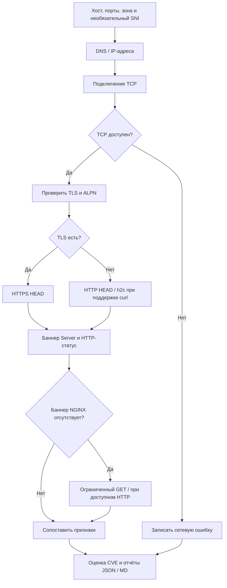

# NGINX HTTP/2 Check

Неразрушающая сетевая проверка веб-сервисов на наличие NGINX, поддержку HTTP/2 и предварительную применимость **CVE-2026-123007** и **CVE-2026-123633**.

**Версия:** 1.1 ([vit81g (Vitaliy S. Novikov)](https://github.com/vit81g))  
**Ответственный:** руководитель службы кибербезопасности [Новиков Виталий Сергеевич](https://wiki.port.one/display/~vs.novikov), администратор ИБ Шелехов Виктор Михайлович  
**Дата:** 11.2026

> **Важно:** инструмент выполняет первичную сетевую диагностику. Наличие HTTP/2 не доказывает уязвимость NGINX, отсутствие положительного результата не доказывает безопасность. Для заключения требуются версия работающего бинарного файла, происхождение пакета, применённые исправления и конфигурация соответствующего сервиса.

## Что изменилось в версии 1.1

1. **Совместимость с Windows:** `--output /dev/null` заменён на переносимый `os.devnull` (`nul` на Windows, `/dev/null` на Linux).
2. **Разделены признаки:** успешный TCP, HTTP-ответ, TLS ALPN `h2`, подтверждённый HTTP/2-ответ, NGINX и версия NGINX.
3. **Распознавание Welcome to nginx!:** если HTTP-ответ не раскрыл NGINX в `Server`, выполняется ограниченный `GET /`. Поиск стандартной HTML-страницы даёт косвенный признак NGINX, а не доказательство установленного ПО. Содержимое ответа не записывается.
4. **Добавлен `--server-name`:** позволяет проверить конкретный виртуальный хост по IP, указав отдельно SNI/HTTP Host.
5. **Более информативная консоль:** для каждого порта выводятся статусы NGINX, HTTP/2 и версия HTTP-ответа.
6. **Добавлены регрессионные тесты:** `test_nginx_http2_check.py`.

## Требования

- Python **3.8+**, стандартная библиотека (без дополнительных Python-пакетов).
- Исполняемый файл `curl` в `PATH`.
- Windows 10/11, Linux; права администратора для сетевого сканирования обычных TCP-портов не требуются.
- Для подтверждения **HTTP/2-ответа** желательно иметь curl с поддержкой `HTTP2`.

Проверка в PowerShell:

```powershell
py -3 --version
where.exe curl
curl.exe -V
```

На Linux:

```bash
python3 --version
command -v curl
curl -V
```

Если в строке `Features:` нет `HTTP2`, скрипт **не сможет отправить HTTP/2-запрос через curl**. Но TLS ALPN с помощью Python остаётся доступен и может обнаружить согласование `h2`. В отчёте это будет отмечено как `alpn_only`, а не как успешный HTTP/2-ответ.

## Быстрый запуск

### Интерактивный режим

PowerShell:

```powershell
py -3 .\nginx_http2_check.py
```

Linux:

```bash
python3 nginx_http2_check.py
```

Пример ввода:

```text
Хост (FQDN/IP): 192.0.2.10
Порт(ы) [Enter = auto]:
Точка проверки [corp/vds/mgmt]: corp
```

Автоматический режим проверяет фиксированный набор TCP-портов:

```text
80, 443, 1443, 3000, 4200, 5000, 8000, 8008,
8080, 8081, 8443, 8888, 9000, 9443
```

Это **не сканирование всех 65535 портов**. Неотвечающие порты обозначаются как `refused` или `unreachable_or_timeout`.

### Проверка конкретного порта

```powershell
py -3 .\nginx_http2_check.py --host 192.0.2.10 --ports 80,443 --zone corp
```

### Проверка отдельного виртуального хоста

```powershell
py -3 .\nginx_http2_check.py `
    --host 192.0.2.10 `
    --server-name web.example.test `
    --ports 443 `
    --zone corp
```

Здесь соединение устанавливается по IP `192.0.2.10`, а в HTTP Host и TLS SNI используется `web.example.test`. Это важно, когда `http://IP/` показывает стандартную страницу NGINX, а рабочий веб-сервис обслуживается другим виртуальным хостом.

### Проверка сертификатов корпоративного PKI

```powershell
py -3 .\nginx_http2_check.py `
    --host web.example.test `
    --ports 443 `
    --zone corp `
    --ca-file .\corporate-root-ca.pem
```

`--insecure-diagnostics` допускает дополнительный запрос **HEAD** без проверки сертификата, только после ошибки доверия к CA. Использовать осознанно: такой ответ не подтверждает подлинность сервиса.

## Что означают режимы CORP, VDS и MGMT

| Значение | Смысл |
|---|---|
| `corp` | Проверка из корпоративной сети |
| `vds` | Проверка с внешней точки |
| `mgmt` | Проверка из отдельной сети управления |

Это **метка источника проверки**, а не переключатель сетевого интерфейса, VRF, VPN или маршрутов. Запускать инструмент нужно непосредственно в соответствующем сегменте.

## Алгоритм



По умолчанию выполняются обычные HEAD-запросы; если NGINX не определён по баннеру и HEAD вернул код до 400 либо 405/501, выполняется дополнительный ограниченный `GET /` с `Range: bytes=0-4095` и лимитом ответа 8192 байт. Сервер может проигнорировать `Range`, поэтому curl ограничивает размер; результат такой проверки не гарантирован. **PoC и вредоносные payload не отправляются**.

## Интерпретация результатов

| Поле | Значение | Интерпретация |
|---|---|---|
| `tcp=open` | Соединение установлено | Порт принимает TCP |
| `tcp=refused` | Отказ | Сокет отклонил соединение |
| `tcp=unreachable_or_timeout` | Ошибка/тайм-аут | Нельзя утверждать, что порт закрыт |
| `nginx_status=header` | `Server: nginx` | NGINX обнаружен по баннеру |
| `nginx_status=welcome_page` | Стандартная HTML-страница | Косвенный признак NGINX; версия неизвестна |
| `nginx_status=not_confirmed` | Нет положительных признаков | NGINX не подтверждён **на данном порту** |
| `h2_status=http2_response` | Получен HTTP/2-ответ | Поддержка HTTP/2 подтверждена на уровне HTTP |
| `h2_status=alpn_only` | ALPN согласовал `h2` | Сервер согласился на h2; HTTP/2-ответ не подтверждён |
| `h2_status=not_detected` | Положительных признаков нет | Не означает, что HTTP/2 выключен |

**Важный пример:** если порт 80 выдаёт `Welcome to nginx!`, а порт 443 согласовывает `h2`, это **два независимых наблюдения**. Они не доказывают, что именно NGINX обслуживает HTTP/2 на порту 443. Версия NGINX на 443 также остаётся неизвестной, пока она не подтверждена отдельно.

Пример ожидаемого вывода (иллюстрация, не результат реального сканирования):

```text
192.0.2.10:80 ... open NGINX=welcome_page Server=- HTTP/2=not_detected HTTP=http/1/200
192.0.2.10:443 ... open NGINX=not_confirmed Server=- HTTP/2=alpn_only HTTP=
```

Если сервер возвращает баннер и действительно отвечает HTTP/2, пример будет иным:

```text
192.0.2.10:443 ... open NGINX=header Server=nginx/1.27.5 HTTP/2=http2_response HTTP=https/2/200
```

### Предварительная оценка CVE

На основании [NGINX Security Advisories](https://nginx.org/en/security_advisories.html) скрипт сравнивает доступную **из HTTP-заголовка** версию NGINX с диапазонами, заданными в коде для двух CVE.

| Результат | Действие |
|---|---|
| NGINX и HTTP/2 подтверждены, версия скрыта | Проверить версию и сборку на хосте |
| NGINX и HTTP/2 подтверждены, версия входит в уязвимый диапазон | Проверить пакет/backport; приоритетное устранение |
| HTTP/2 не обнаружен | Проверить фактическую конфигурацию NGINX |
| Баннер соответствует исправленной версии | Подтвердить фактический бинарный файл/пакет |
| Наличие upstream для CVE-2026-123633 | Проверить конфигурацию отдельно на сервере |

Отсутствие эксплойта и отсутствие аварийного завершения сервера не являются подтверждением отсутствия CVE.

## Отчёты

Результаты автоматически сохраняются в `nginx_reports/`:

```text
nginx_reports/
├── web.example.test_corp_<UTC>.json
└── web.example.test_corp_<UTC>.md
```

В JSON присутствуют `h2_status`, `nginx_status`, `nginx_versions`, `assessment` и TLS/HTTP-пробы для **каждого IP:порта**. MD содержит таблицу и предварительные оценки обеих CVE. Тела HTTP-ответов, cookies и Authorization в отчёт не включаются.

## Структура исходного кода

| Функция | Назначение |
|---|---|
| `host_name` | Проверяет один FQDN/IP и преобразует имя в IDNA |
| `parse_ports` | Обрабатывает auto и список портов |
| `tls_probe` | Выполняет TLS-рукопожатие и проверяет ALPN |
| `curl_head` | Получает метаданные HTTP HEAD переносимым способом |
| `curl_body_fingerprint` | Проверяет ограниченную страницу Welcome (без сохранения тела) |
| `indicators` | Независимо классифицирует HTTP/2, NGINX и CVE |
| `examine` | Проверяет отдельную пару IP/порт |
| `clean` | Экранирует строковые значения Markdown |
| `markdown` | Формирует MD-отчёт |
| `main` | CLI, сетевой цикл, вывод и файлы |

Docstring всех функций написаны на русском языке; код сохраняет стиль PEP 8 (отступы, snake_case, UPPER_CASE, длина строк до 79 символов).

## Тестирование

```powershell
py -3 -m unittest -v test_nginx_http2_check.py
py -3 -m py_compile nginx_http2_check.py
```

Тесты используют локальный HTTP-сервер и не отправляют запросы в корпоративную сеть.

**Подтверждено в локальной среде разработки:** компиляция Python, пять модульных тестов, проверка распознавания Welcome-страницы, разделение ALPN/NGINX, классификация версии и структура MD-таблицы. **Не проверено:** выполнение в Windows и интеграционная проверка настоящего HTTP/2-сервера с конкретной версией curl.

## Ограничения

- По HTTP невозможно надёжно установить сборку NGINX, наличие backport и параметры `nginx -T`.
- NGINX на порту 80 не обязательно обслуживает порт 443; SNI и virtual host могут менять результат.
- ALPN может принадлежать промежуточному балансировщику/WAF, а не backend-серверу.
- Дополнительный GET не гарантирует распознавание NGINX и может быть запрещён сетевыми средствами.
- Если curl не поддерживает HTTP/2, тест h2c не выполняется, а TLS ALPN фиксируется отдельно.
- При проверке по IP сертификат может относиться к виртуальному хосту по умолчанию; используйте `--server-name`.
- Для корректной классификации необходимы официальный бюллетень производителя и данные работающего экземпляра NGINX.
- Проверка обычными сетевыми запросами должна выполняться только в рамках согласованного перечня систем.

## Источники

- [NGINX: Security Advisories](https://nginx.org/en/security_advisories.html)
- [NGINX: HTTP/2 Module](https://nginx.org/en/docs/http/ngx_http_v2_module.html)
- [NGINX: News 2026](https://nginx.org/2026.html)
- [curl: документация CLI](https://curl.se/docs/manpage.html)
- [Python: os.devnull](https://docs.python.org/3/library/os.html#os.devnull)
- [Python: ssl](https://docs.python.org/3/library/ssl.html)
- [PEP 8](https://peps.python.org/pep-0008/)
- [PEP 257](https://peps.python.org/pep-0257/)
