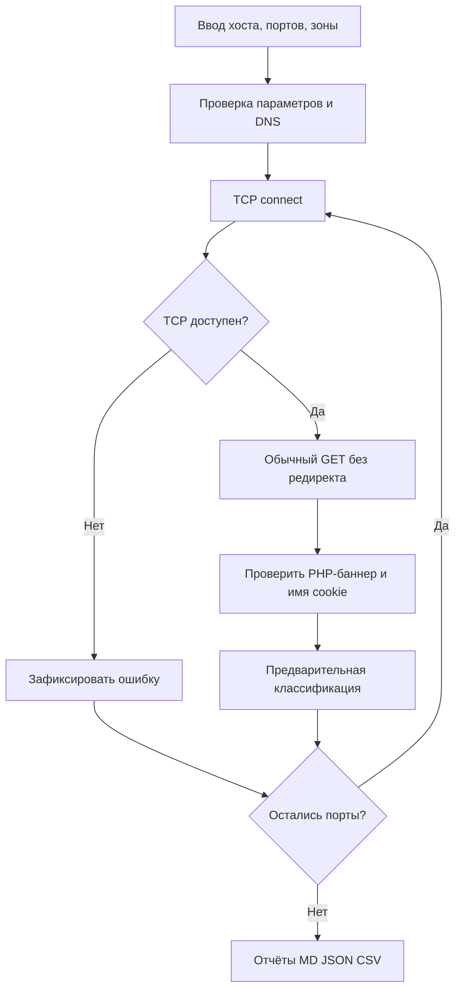

# PHP2Shell - проверка применимости CVE

**Версия:** 1.1 ([vit81g (Vitaliy S. Novikov)](https://github.com/vit81g))  
**Ответственный:** руководитель службы кибербезопасности [Новиков Виталий Сергеевич](https://wiki.port.one/display/~vs.novikov), администратор ИБ Шелехов Виктор Михайлович  
**Дата:** 11.2026

## 1. Назначение

Инструмент предварительной сетевой оценки PHP2Shell на разрешённых к проверке корпоративных ресурсах. Использует обычные HTTP GET без тела, без аутентификации и без перехода по перенаправлениям. Не эксплуатирует уязвимости, не проверяет устойчивость к RCE/DoS и не подтверждает эффективность WAF.

Методическая основа: файл `scanner/php_cve_scanner.py` из архива `php2shell-for-IB-2026-10-23.tar.gz`. Текущая реализация является самостоятельной адаптацией подхода к инвентаризации. Остальные материалы архива (PoC, активный стресс-сканер, стенды и демонстрация deface) не входят в комплект. Авторство и лицензия исходного одиночного файла отдельно не установлены; перед публичным размещением согласуйте публикацию и реквизиты авторства. Лицензия MIT из соседнего проекта относится к нему, а не автоматически ко всему архиву.

## 2. Уязвимости

| Идентификатор | Описание | CVSS 4.0 |
|---|---|---:|
| CVE-2026-109618 | Повреждение памяти при OOM | 9.2 |
| CVE-2026-109619 | Use-after-free при сохранении глобального состояния | 9.2 |

Исправления опубликованы 21.10.2026. По данным Canadian Centre for Cyber Security, обе CVE добавлены в CISA KEV 26.10.2026. Источники - раздел 12.

| Ветка PHP | Первая исправленная upstream-версия для обеих CVE |
|---|---|
| 8.2 | 8.2.35 |
| 8.3 | 8.3.36 |
| 8.4 | 8.4.27 |
| 8.5 | 8.5.12 |

Для остальных веток и суффиксов требуется проверка бюллетеня поставщика и фактической сборки. Вендорские backport-исправления могут присутствовать в пакетах с более низким номером. Таблица относится только к данным двум CVE; не является проверкой всех уязвимостей PHP.

## 3. Требования и запуск

Python 3.8+, стандартная библиотека. Сторонние пакеты, curl, root и SSH не требуются. Рекомендуется поддерживаемая версия Python. Запускать из соответствующей зоны на хосте с разрешённым доступом к объекту.

```bash
python3 --version
python3 php_cve_scanner.py --help
python3 php_cve_scanner.py
```

Иллюстративный диалог:

```text
Хост (FQDN/IP): app.example.test
Порты [Enter = auto]:
Зона [corp/vds/mgmt, Enter=corp]: corp
```

| Зона | Смысл |
|---|---|
| corp | Корпоративная сеть |
| vds | Внешняя точка проверки |
| mgmt | Сеть управления / VRF Management |

Зона является меткой отчёта, не переключает сеть или интерфейс. Запускать скрипт физически или логически из соответствующего сегмента.

### 3.1. Примеры CLI

```bash
python3 php_cve_scanner.py --target app.example.test --zone corp
python3 php_cve_scanner.py --target app.example.test --ports 443 --zone vds
python3 php_cve_scanner.py --target app.example.test --ports 8444 --scheme https --zone mgmt
python3 php_cve_scanner.py --target app.example.test --ports 443 --path / --path /index.php --csv
python3 php_cve_scanner.py --target app.example.test --ports 443 --ca-file corporate-ca.crt
```

Для нестандартных портов явно задавайте `--scheme http` или `--scheme https`. `auto` назначает схему по таблице типовых портов, а не распознаёт произвольный протокол. Для порта с неизвестной схемой выполните две отдельные разрешённые проверки. Не отправляйте HTTP-запросы на известные не-HTTP сервисы.

Дополнительная проверка TCP-порта предполагаемого PHP-FPM, только если порт согласован для проверки:

```bash
python3 php_cve_scanner.py --target app.example.test --ports 443 --fpm-port 9000
```

Открытый TCP/9000 не доказывает наличие PHP-FPM. Данные FastCGI не отправляются.

### 3.2. Параметры

| Ключ | Описание |
|---|---|
| `--target`, `--host` | Один FQDN/IP без URL или CIDR. При отсутствии - интерактивный ввод |
| `--ports`, `--port` | `auto` либо список через запятую, до 16 уникальных портов |
| `--zone` | corp/vds/mgmt, по умолчанию corp |
| `--scheme` | auto/http/https |
| `--path` | Абсолютный путь на том же хосте; повторяется до 8 уникальных путей |
| `--timeout` | Таймаут отдельных сетевых операций, 0.5–30 с, по умолчанию 5 с; не общий дедлайн |
| `--delay` | Пауза перед каждым GET, 0.3–30 с, по умолчанию 0.5 с |
| `--ca-file` | Дополнительный доверенный CA в PEM из проверенного источника |
| `--insecure` | Диагностический режим без проверки TLS, явно отмечается в JSON/MD; не применять для подтверждения подлинности |
| `--fpm-port` | Дополнительный TCP connect без отправки данных |
| `--output-dir` | Каталог отчётов, по умолчанию php_reports |
| `--csv` | Дополнительно сохранять CSV |

Автопорты: 80, 443, 1443, 8000, 8080, 8081, 8443, 8888, 9443. HTTPS по умолчанию на 443, 1443, 8443, 9443; другие - HTTP. Это не полный поиск портов. TCP доступность проверяется отдельно от HTTP. Схема `auto` может пропустить нестандартное размещение сервиса.

По умолчанию проверяются `/` и `/index.php`; дополнительные известные точки входа указываются оператором. Входные параметры запроса, аутентификация, автоматическое сканирование каталогов и поиск скрытых административных ресурсов не используются. Один хост за запуск, без многопоточности и CIDR.

## 4. Алгоритм



HTTP-коды 301, 401, 403, 404 и 500 могут содержать полезный баннер; они не приравниваются к подтверждению уязвимости. Ответы разных путей фиксируются отдельно. Значения cookies, тела ответов и Location не сохраняются. Полный X-Powered-By также не сохраняется: извлекается только версия PHP и категория. При этом имена хостов, IP и пути являются внутренней технической информацией.

## 5. Правила оценки

| Код | Иллюстративное наблюдение | Интерпретация |
|---|---|---|
| potentially_affected | PHP/8.2.34 | Версия ниже 8.2.35; проверить пакет, backport и веб-SAPI |
| fixed_banner | PHP/8.2.35 | Баннер не ниже порога; подтвердить установленную сборку |
| unknown_build | PHP/8.2, PHP/8.2.35RC1, PHP/7.4.33 | Неполная версия, суффикс или ветка вне таблицы; нужна проверка производителя |
| php_hint | PHP без версии или PHPSESSID | Косвенный признак PHP, версия неизвестна; cookie не доказательство выполнения PHP |
| not_detected | Отсутствуют признаки | Не исключает наличие PHP |
| unavailable | Ошибка TCP, TLS или HTTP | Нет достаточных данных |
| tcp_only | TCP/9000 открыт | Протокол не определён |

Баннер не является доказательством RCE, установки патча или отсутствия уязвимости. Он может быть изменён прокси либо приложением. WAF, балансировщики, виртуальные хосты, несколько IP и различия между backend могут влиять на результат. Для HTTPS используйте FQDN, чтобы SNI и проверка имени сертификата соответствовали ресурсу. Скрипт фиксирует IP TCP-проверки, но отдельное HTTP-соединение может попасть на другой адрес; не гарантируется обследование каждого адреса DNS. HTTP/2 не проверяется; применяется стандартный HTTP-клиент urllib.

## 6. Отчёты

Пример консольного вывода (иллюстрация, не результат PROD):

```text
https:443 / 8.2.34: Потенциально уязвим (по баннеру)
https:443 /index.php -: Признаки PHP не выявлены
Отчёт: php_reports/app.example.test_corp_<timestamp>.md
Отчёт: php_reports/app.example.test_corp_<timestamp>.json
```

JSON содержит `version`, `generated_at` (UTC), `host`, `zone`, `resolved_ips`, `cves`, `tls_verify`, `paths`, `results`. Для каждой точки фиксируются порт, схема, TCP-доступность, IP TCP-соединения, ошибка и список наблюдений по путям (HTTP-статус, PHP-версия, категория, обоснование).

Коды завершения: `0` - все наблюдения имеют категорию fixed_banner (не доказательство безопасности); `1` - ошибка запуска/записи/DNS; `2` - найден хотя бы один potentially_affected; `3` - неполный результат (включая отсутствие признаков и недоступные порты). Ошибки синтаксиса CLI также возвращают 1. Не интерпретируйте код без отчёта. Для интеграции использовать JSON и проверять наличие актуального файла.

## 7. Структура кода

| Функция/класс | Назначение |
|---|---|
| ArgumentParser.error | Ошибки CLI возвращают 1, а не 2 |
| NoRedirect.redirect_request | Не следовать 3xx |
| validate_host | Валидация одиночного адреса |
| parse_ports | Разбор портов и ограничения |
| validate_paths | Разбор путей, запрет URL/query/fragment |
| classify_php | Сопоставление баннера с FIXED |
| resolve_host | Разрешение адресов DNS |
| tcp_check | Проверка доступности TCP |
| make_request | Извлечение признаков из HTTP-ответа |
| probe_port | Последовательная проверка одного порта |
| scan | Координация проверки и сбор метаданных |
| report_rows | Представление наблюдений, включая ошибки |
| write_reports | Запись MD, JSON и CSV |
| build_parser | Описание CLI |
| main | Ввод, валидация, запуск и exit code |

Основные переменные: `FIXED` - ветка и номер исправленного patch-релиза; `CVES` - идентификаторы; `DEFAULT_PORTS`, `TLS_PORTS` - соглашения портов; `DEFAULT_PATHS` - два стандартных пути; `MAX_PORTS`, `MAX_PATHS`, `MIN_DELAY` - ограничения; `STATUS_LABELS` - русскоязычные обозначения категорий. `document` - общий результат одного запуска; `result` - наблюдения на порту; `row` - одно наблюдение для отчёта. `context` - SSLContext с выбранным режимом доверия; `banner` - временная строка заголовка, которая не записывается целиком.

## 8. Отличия от исходного архива

- Интерактивный ввод по аналогии с NGINX-проверкой; сетевые зоны и единый каталог отчётов.
- Один хост за запуск; исключены CIDR, многопоточность, deep-presence, автоматический обход CGI/phpinfo/FPM status, стресс-корпусы и PoC. Список дополнительных путей задаётся оператором.
- Не завершать проверку после первого найденного признака: хранить отдельные наблюдения по путям.
- Неполные и нестандартные номера версий не переводятся в однозначно уязвимые или исправленные.
- Сохранять ошибки и отсутствие признаков, а не только положительные находки.
- Не читать тело ответа; не сохранять cookies и содержимое URL перенаправления; TLS проверяется по умолчанию.
- Оригинальные CLI-ключи `--subnet`, `--threads`, `--wordlist`, `--deep-presence`, `--output`, `--http`, `--https` не поддерживаются. Это осознанное изменение интерфейса, а не полностью обратно совместимое обновление.

## 9. Подтверждение на сервере

Проверить реальный веб-SAPI (CLI может отличаться от PHP-FPM/mod_php):

```bash
php -v
ps -eo pid,user,args | grep '[p]hp-fpm'
# Debian/Ubuntu
 dpkg -l | grep -E 'php[0-9]|libapache2-mod-php'
# RPM-based
 rpm -qa | grep -E '^php'
# Alpine
 apk info -v | grep -E '^php'
# Docker: определить нужный контейнер, затем версию внутри него
 docker ps --format '{{.Names}} {{.Image}}'
 docker exec CONTAINER php -v
```

Не все команды доступны во всех ОС. Уточнить активный бинарный файл, версии пакетов, источник сборки, наличие backport, конфигурацию PHP-FPM/веб-сервера и факт перезапуска рабочих процессов после установки патча. Сверить результат с официальным бюллетенем производителя пакета. Не публиковать phpinfo для диагностики. Не менять контейнеры вендора напрямую.

## 10. Решение службы ИБ

При выявлении PHP ниже пороговой версии или неизвестной версии на критичном сервисе зарегистрировать проверку применимости CVE. При подтверждённой уязвимой сборке создать заявку на обновление, согласовать сроки, при необходимости ограничить сетевой доступ и проверить рекомендации вендора по временным мерам. После исправления повторить сетевую и локальную проверку. Отсутствие баннера, результат 403, закрытый порт или наличие WAF сами по себе не являются основанием для закрытия CVE.

## 11. Тестирование и публикация

```bash
python3 -m py_compile php_cve_scanner.py
python3 -m unittest -v
```

Тесты работают только с локальным HTTP-сервером и искусственными баннерами; не воспроизводят CVE. Каталог отчётов исключён в `.gitignore`. Перед размещением на GitHub проверить содержимое, разрешение на публикацию ФИО и внутренней Wiki, не добавлять архив исследования, реальные отчёты, ключи, сертификаты и журналы. Документация оформлена с учётом PEP 8 / PEP 257; полное соответствие проверяется отдельно линтером.

## 12. Источники

- [PHP 8.2.35 Release Announcement](https://www.php.net/releases/8_2_35.php)
- [PHP News Archive 2026](https://www.php.net/archive/2026.php)
- [CERT-EU 2026-018](https://cert.europa.eu/publications/security-advisories/2026-018/)
- [Canadian Centre for Cyber Security AL26-026](https://www.cyber.gc.ca/en/alerts-advisories/al26-026-critical-vulnerabilities-impacting-php-cve-2026-109618-and-cve-2026-109619)
- [NCSC-NL PHP2Shell](https://github.com/NCSC-NL/php2shell)
- [Python urllib.request](https://docs.python.org/3/library/urllib.request.html)
- [PEP 8](https://peps.python.org/pep-0008/) и [PEP 257](https://peps.python.org/pep-0257/)

Дата сверки пороговых версий: 19.11.2026. Перед повторным использованием актуализировать сведения производителя.
